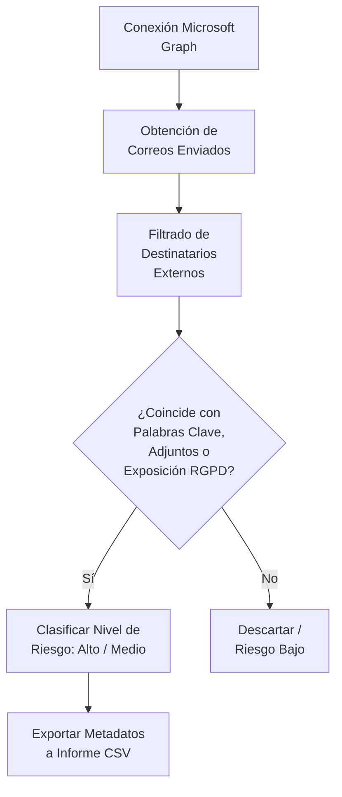

# Auditor de Prevención de Fuga de Datos (DLP) para Entornos de Producción Audiovisual

Herramienta de automatización y auditoría de seguridad desarrollada sobre **Microsoft Graph API** y **PowerShell**, diseñada específicamente para detectar riesgos de filtración de información confidencial en los flujos de comunicación con actores, agencias y equipos de producción externa.

---

## 1. Justificación y Enfoque del Proyecto

### Por qué este caso de uso
En lugar de plantear una auditoría genérica de identidades o licencias, esta herramienta se centra en un vector de riesgo operativo real y crítico dentro del sector audiovisual: la gestión de información confidencial por correo electrónico. 

Durante una producción se maneja propiedad intelectual de alto valor (guiones preliminares, planes de rodaje) y datos personales sensibles de actores, extras y personal técnico (contratos, documentos de identidad, datos bancarios). Un error humano cotidiano —como enviar un archivo confidencial a un correo personal externo, equivocarse de destinatario o realizar un envío masivo sin copia oculta— supone una brecha directa de seguridad, el incumplimiento de acuerdos de confidencialidad (NDAs) y posibles sanciones bajo el RGPD.

### Valor técnico y metodológico
* **Uso del estándar actual:** Implementado íntegramente sobre el SDK oficial de **Microsoft Graph**, sustituyendo módulos heredados y preparando la herramienta para una integración moderna en entornos Microsoft 365.
* **Detección orientada al negocio:** Traduce reglas técnicas (análisis de destinatarios, metadatos de adjuntos y palabras clave) en indicadores claros de riesgo operativo.
* **Privacidad desde el diseño (Data Minimization):** La herramienta no descarga ni almacena copias de los correos ni de los documentos adjuntos; recopila exclusivamente los metadatos indispensables para la trazabilidad y la auditoría interna.

---

## 2. Características Principales

* **Filtro de Destinatarios Externos:** Identifica automáticamente correos enviados a dominios ajenos a la organización (ej. cuentas personales `@gmail.com`, `@outlook.com` o agencias externas).
* **Análisis Semántico de Palabras Clave:** Busca términos críticos en el asunto y la vista previa del mensaje (ej. *guion, script, call sheet, rodaje, contrato, presupuesto, DNI, IBAN, casting*).
* **Auditoría de Archivos Adjuntos:** Verifica si los correos externos incluyen archivos adjuntos, elevando automáticamente la criticidad de la alerta.
* **Detección de Brechas de Privacidad (RGPD):** Alerta cuando se realizan envíos masivos a múltiples destinatarios externos utilizando el campo `Para` (`To`) en lugar de Copia Oculta (`BCC`), evitando la exposición de direcciones personales entre terceros.
* **Clasificación por Niveles de Riesgo:** Categoriza los hallazgos en niveles (Bajo, Medio, Alto) para facilitar la priorización por parte del equipo de seguridad.
* **Generación de Informes Estructurados:** Exporta los resultados a un archivo CSV limpio y listo para su análisis o reporte.

---

## 3. Arquitectura y Flujo de Ejecución



---

## 4. Requisitos Previos

* **Sistema:** Windows con PowerShell 5.1 o superior, o entornos multiplataforma con PowerShell Core 7+.
* **Módulo de Microsoft Graph para PowerShell:**
  ```powershell
  Install-Module Microsoft.Graph -Scope CurrentUser
  ```
* **Permisos requeridos en Microsoft Entra ID:**
  * `Mail.Read` (Permiso delegado para auditoría individual o permiso de aplicación con consentimiento de administrador para auditoría centralizada).

---

## 5. Instrucciones de Uso

1. Descargar el script de auditoría (`Auditoria_FugaDatos_Produccion.ps1`) en el entorno de ejecución.
2. Abrir una consola de PowerShell e iniciar sesión en Microsoft Graph solicitando el ámbito de lectura de correo:
   ```powershell
   Connect-MgGraph -Scopes "Mail.Read"
   ```
3. Editar las variables de configuración en la cabecera del script para adaptarlas al entorno:
   * `$DominioInterno`: Dominio corporativo de la organización (ej. `@tuproductora.com`).
   * `$UsuarioAuditar`: Buzón objetivo (`"me"` para el usuario actual o la dirección UPN del usuario a auditar).
   * `$PalabrasClave`: Listado de términos confidenciales adaptados al proyecto.
4. Ejecutar el script:
   ```powershell
   .\Auditoria_FugaDatos_Produccion.ps1
   ```
5. Consultar el resumen en consola o abrir el archivo generado en el mismo directorio (`.\Auditoria_FugaDatos_Produccion.csv`).

---

## 6. Escalabilidad a Entornos de Producción

Aunque el script está preparado para ejecutarse de forma interactiva durante fases de prueba o auditorías puntuales, su arquitectura permite escalarlo fácilmente a un entorno desatendido mediante:

1. **Registro de Aplicación (App Registration):** Configuración en Microsoft Entra ID con permiso de aplicación `Mail.Read` y autenticación basada en certificado.
2. **Automatización Programada:** Ejecución periódica mediante Azure Automation o tareas programadas para analizar de forma continua los buzones de los departamentos de producción y dirección de casting.